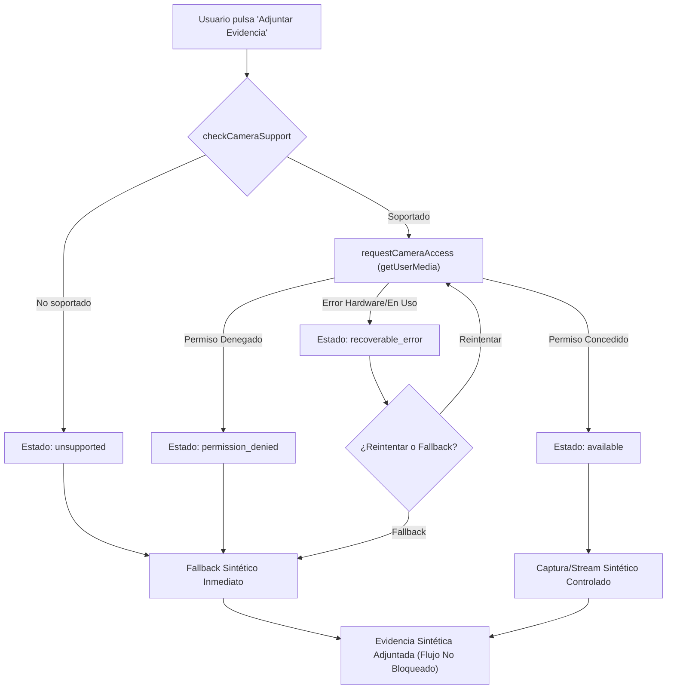

# Registro de Decisiones de Capacidades del Dispositivo: Cámara Opcional y Fallback

**Módulo:** `src/lib/device/camera.ts`  
**Responsable:** Armando Valerio Salmeron (`ArmandoValerio`)  
**Estatus:** Implementado y Verificado  
**Rúbricas asociadas:** AC-02, AC-03, AC-04  

---

## 1. Contexto y Problema

Durante las inspecciones en laboratorios universitarios, los inspectores pueden requerir registrar evidencia fotográfica de las condiciones del equipo o las instalaciones. Sin embargo:
1. Las condiciones de hardware varían drásticamente (computadoras de escritorio sin webcam, laptops con cámara deshabilitada, permisos denegados).
2. Los contextos no seguros (HTTP) o directivas restrictivas del navegador deshabilitan `navigator.mediaDevices`.
3. El usuario puede legítimamente rechazar el permiso de acceso a la cámara.

**Principio fundamental de diseño:** La cámara es una **mejora progresiva opcional** (*progressive enhancement*). La ausencia de cámara o el rechazo de permisos **jamás debe bloquear** el flujo de trabajo de la inspección.

---

## 2. Decisiones Técnicas

### 2.1 Activación bajo Acción Explícita
El módulo no consulta ni solicita permisos al cargar la aplicación ni al importarse (`no-eager permission request`). La cámara solo se solicita cuando el usuario presiona expresamente el control de captura/adjunción.

### 2.2 Clasificación de Estados
El módulo normaliza el resultado en cuatro estados semánticos:

| Estado | Condición | Comportamiento |
| :--- | :--- | :--- |
| `available` | `getUserMedia` resuelve con éxito | Obtiene `MediaStream` controlado para captura sintética. |
| `unsupported` | Entorno sin `mediaDevices` o HTTP | Omite la solicitud y ofrece fallback inmediato sin errores. |
| `permission_denied` | `NotAllowedError` / rechazo | Respeta la privacidad del usuario; activa fallback manual. |
| `recoverable_error` | Hardware ocupado o restricción | Permite al usuario reintentar o saltar directamente al fallback. |

### 2.3 Privacidad Estricta y Evidencia Sintética
- **Sin fotos reales:** Conforme a las restricciones académicas y de privacidad, no se capturan, procesan ni almacenan fotografías reales en el repositorio ni en servidores.
- **Sin PII:** No se recopilan datos biométricos, metadatos EXIF reales, identificadores de cámara ni geolocalización física.
- **Evidencia Sintética:** El fallback genera un registro canónico identificable (`checksum`, dimensiones estándar, etiqueta sintética y timestamp) que garantiza la idempotencia y trazabilidad de la inspección sin comprometer datos personales.

---

## 3. Diagrama de Flujo del Fallback



---

## 4. Matriz de Compatibilidad y Fallbacks

```
Dispositivo Móvil / PWA con HTTPS --> Cámara disponible --> Evidencia adjunta
Navegador Escritorio sin cámara     --> No soportado      --> Fallback manual (sin bloqueo)
Usuario deniega permiso             --> Permiso denegado  --> Fallback manual (sin bloqueo)
Error de hardware (cámara en uso)   --> Error recuperable --> Opción de reintento / Fallback
```

---

## 5. Límites Encontrados y Trabajo Futuro

1. **Restricción de iOS Safari:** Safari requiere interacción de toque directo de usuario sincrónica para habilitar streams de video; en un entorno de producción debe asegurarse que la promesa sea disparada directamente por el evento `click`.
2. **Persistencia de Blobs:** En esta etapa se generan descriptores de evidencia sintética; en la integración con almacenamiento persistente se integrará con el almacenamiento local offline (`src/lib/storage/schema.ts`).
3. **Liberación de Recursos:** Se implementa `stopCameraStream` para apagar inmediatamente las pistas de hardware y evitar que el indicador led de la cámara permanezca encendido innecesariamente.
